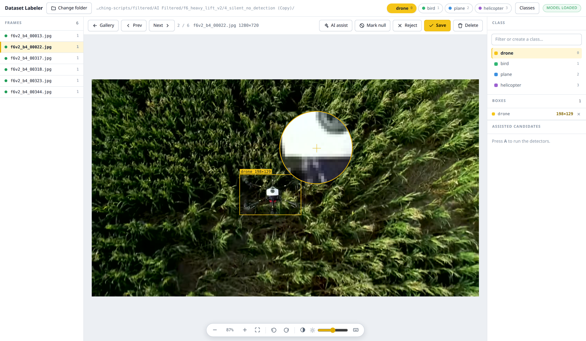
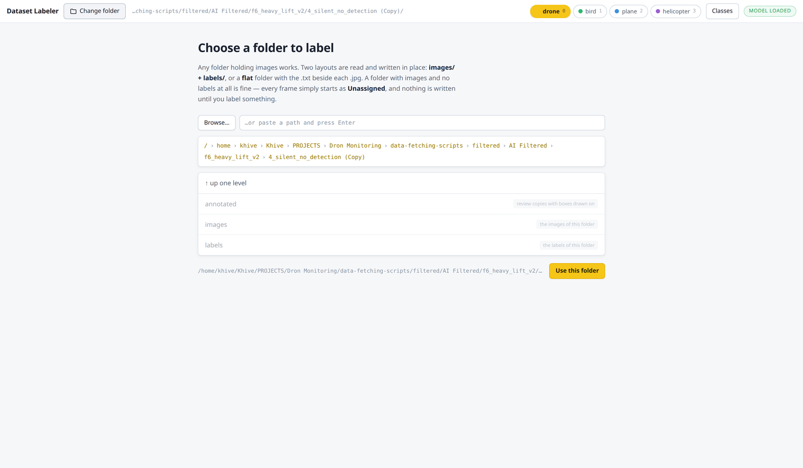
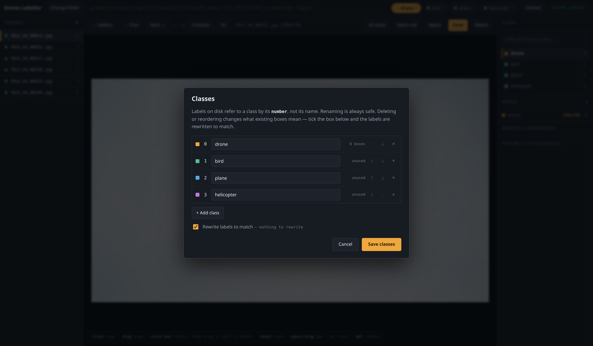
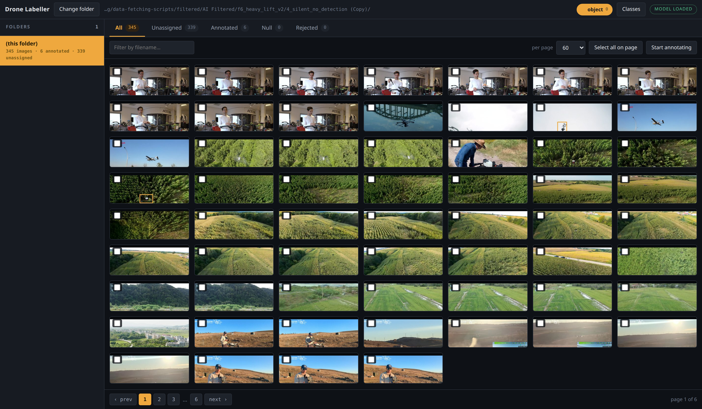
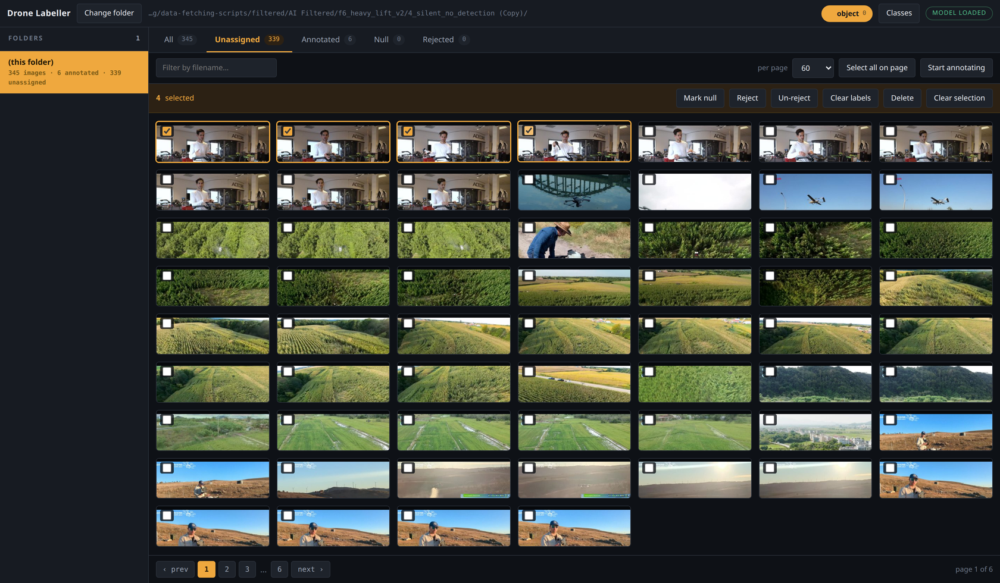
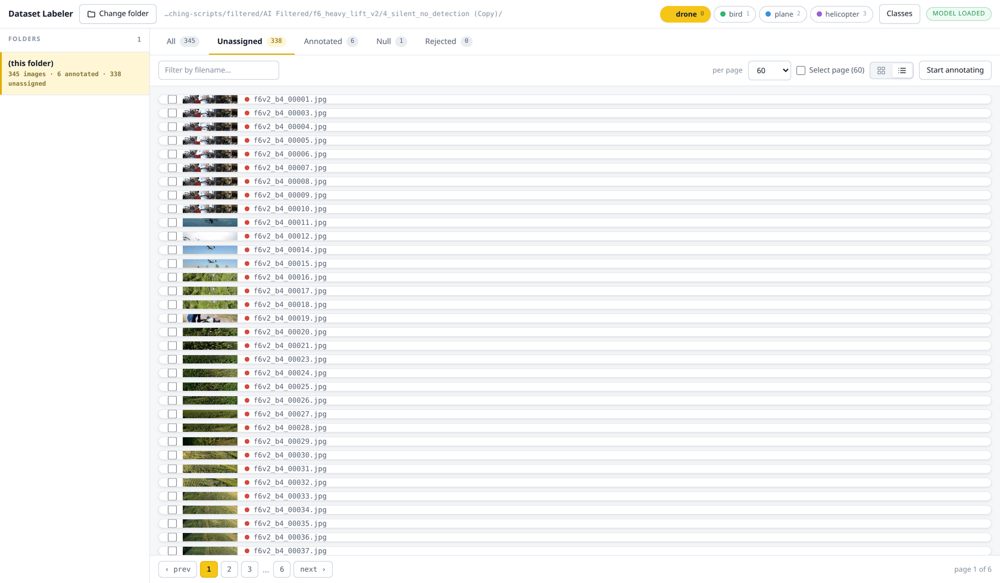

# Dataset Labeler

A local web tool for drawing bounding boxes on folders of images, built for targets that are
only a handful of pixels across.

It reads and writes YOLO labels **in place**, beside your images. There is no project to create,
no upload, no export step and no account. Point it at a folder and start.



*A drone against dense vegetation. The loupe follows the cursor at 8×, so a target you can
barely see is still a target you can box.*

## Why this exists

It was written for a drone-detection dataset, after an afternoon of the opposite approach.
Frames were being pre-labelled by a detection model and corrected afterwards. On one clip the
model scored **nothing above 0.05 on any frame** — including frames where the aircraft filled
300 pixels — while a person looking at the same frames could point at it immediately.

That is the gap this tool is for. Below roughly 20 px a drone and a bird are not separable in a
single frame, and no detector will tell you which is which. A person with contrast enhancement
and an 8× loupe can often still tell, because they can use the trajectory, the context and the
shape of the thing. The tool's job is to make that person fast, not to replace them.

So these things here exist because of what those frames are:

**Contrast on demand.** Many hard frames have the target in shade against a building, where the
region averages 52 out of 255 and nothing is visible in the raw image. One key serves the frame
through CLAHE and it appears. The enhancement is **for looking only** — the image on disk is
never modified.

**Boxes only from a deliberate drag.** Clicks and double-clicks never create a label, so a fast
pair of clicks can't drop a box somewhere random. A separate pan tool (or holding Ctrl) moves
the view around without any risk of drawing.

**Assisted candidates, not an oracle.** `A` runs a detection model, frame differencing and a
local z-score, and lists what each found. They are suggestions to accept or ignore. The model is
never trusted on its own — it is usually the model being retrained, which is why the frames need
labelling in the first place.

## Requirements

| | |
|---|---|
| **Python 3.10 or newer** | the code uses `X \| None` type syntax, which 3.9 cannot parse |
| **A desktop session** | it opens a browser window; it is a local tool, not a hosted one |
| `zenity` or `kdialog` | optional, for the native **Browse…** dialog. Falls back to `tkinter`, and you can always paste a path instead |

Linux, macOS and WSL all work. Everything else is installed by pip in step 2.

### Step 0: check your Python

```bash
python3 --version
```

If that prints 3.10 or higher, skip ahead. Otherwise:

```bash
# Debian / Ubuntu
sudo apt update && sudo apt install -y python3 python3-venv python3-pip

# Fedora
sudo dnf install -y python3 python3-pip

# macOS, with Homebrew
brew install python
```

For the native folder dialog on Linux, if you do not already have it:

```bash
sudo apt install -y zenity        # Debian / Ubuntu
sudo dnf install -y zenity        # Fedora
```

macOS and Windows get the dialog through `tkinter`, which ships with Python.

## Install

### Step 1: get the code

```bash
git clone https://github.com/ABIDULLAH786/dataset-labeler
cd dataset-labeler
```

### Step 2: create a virtual environment and install into it

```bash
python3 -m venv .venv
.venv/bin/pip install --upgrade pip
.venv/bin/pip install -r requirements.txt
```

That installs FastAPI, Uvicorn, OpenCV, NumPy and Pydantic, about 100 MB. A virtual environment
keeps them off your system Python, and the launcher looks in `.venv` first, so nothing needs to
be activated later.

### Step 3 (optional): the detection model

Only needed for the **AI assist** button. Everything else works without it.

```bash
.venv/bin/pip install ultralytics
```

Then point the tool at your weights, either way round:

```bash
export LABELLER_MODEL=/path/to/weights.pt    # or
cp /path/to/weights.pt model.pt              # beside the script
```

### Step 4: put the launcher on your PATH

```bash
mkdir -p ~/.local/bin
ln -s "$PWD/labeller" ~/.local/bin/labeller
```

If `labeller` is not found afterwards, `~/.local/bin` is not on your PATH. Add it:

```bash
echo 'export PATH="$HOME/.local/bin:$PATH"' >> ~/.bashrc && source ~/.bashrc
```

### Step 5: check it works

```bash
labeller --help
```

## Run

```bash
cd /some/folder/of/images
labeller
```

That is the whole thing. It prints the folder and the URL, opens your browser, and serves from
the first free port starting at 8077, so two folders can be open side by side.

```
folder  /home/you/datasets/clip-03
open    http://127.0.0.1:8077
```

Other ways to start it:

| | |
|---|---|
| `labeller path/to/images` | label that folder instead of the current one |
| `labeller . --no-model` | skip the model, starts in about a second |
| `labeller --port 9000` | pin a port |

Stop it with `Ctrl+C` in the terminal it is running in.

### First run: create a class

There is no default class, on purpose, so nothing gets written as a made-up `object`. The header
shows **No classes yet, create one** and drawing is refused until there is one.

Type a name into **Filter or create a class** on the right and press Enter. It is then remembered
for every folder you open afterwards, so this is a one-time step.

### Running the server directly

The launcher is a convenience. The server takes the same work:

```bash
.venv/bin/python server.py                                 # browse from your home directory
.venv/bin/python server.py --root /path/to/folder          # open with that folder selected
.venv/bin/python server.py --base /mnt/data --port 8001    # start the browser under /mnt/data
.venv/bin/python server.py --root ... --lock-base          # refuse anything outside --base
.venv/bin/python server.py --root ... --model weights.pt   # enable assisted candidates
```

### If something goes wrong

| Symptom | Cause |
|---|---|
| `ModuleNotFoundError: No module named 'cv2'` | step 2 was skipped, or a different Python is being used. The launcher reports which interpreters it tried |
| `labeller: command not found` | `~/.local/bin` is not on your PATH, see step 4 |
| `no free port between 8077 and 8097` | 21 instances are already running. `pkill -f server.py` clears them |
| **Browse…** does nothing | no `zenity`, `kdialog` or `tkinter`. Paste the path into the box beside it instead |
| The browser shows an old version after an update | hard-reload with `Ctrl+Shift+R` |

## Choosing a folder



**Browse…** opens your desktop's own folder chooser — a browser cannot hand back a filesystem
path, but this server runs on the same machine, so it opens the dialog itself. A path can also
be pasted.

Every directory reports how many images it holds, how many are already labelled and which layout
it is, so you can tell a dataset folder from its parent before opening it. Both layouts are read
and written **in place**:

```
images/ + labels/     <folder>/images/*.jpg   with   <folder>/labels/*.txt
flat                  <folder>/*.jpg          with   <folder>/*.txt beside them
```

**A folder with images and no label files at all is fine.** Every frame starts as
**Unassigned**, nothing is written until you label something, and `labels/` is created on the
first save. Optional `annotated/`, `crops/` and `REVIEW.csv` are kept in step when they already
exist, and are never created.

## Classes



There is no default class. A made-up `object` ends up written into real label files by whoever
does not notice it, so the tool refuses to invent one: with none defined it says so, and drawing
is refused with a reason rather than silently producing boxes of class 0.

On opening a folder the class list is read from whatever that dataset already carries, searching
up to four levels because a YOLO dataset keeps `data.yaml` at its root while the folder you are
labelling is usually a split inside it:

1. `classes.txt` in the selected folder — what this tool writes, and it wins outright
2. any `*.yaml` / `*.yml` with a `names:` field, in block or inline form
3. `notes.json`, which COCO-style exports leave behind
4. the last list you used, remembered in `~/.config/dataset-labeler/classes.txt`

That last one is why a class list is created once and then carries across folders.

> **Class indices are positional.** A label file says `2 0.51 0.44 0.03 0.02`, not `plane`.
> Renaming is therefore free, but deleting or reordering changes what every box already on disk
> means. Leave **Rewrite labels to match** ticked and the labels are rewritten for you:
>
> | | what happens to the labels |
> |---|---|
> | rename | nothing — the index did not move, so every box still means the same thing |
> | reorder | renumbered, so every box still means what it did |
> | delete | that class's boxes are removed, and you are told how many first |
>
> Each row shows how many boxes across the whole folder actually use that class, counted before
> you decide.

## The gallery



Folders run to thousands of frames, so the gallery opens first: cards in a grid, paged, with the
boxes drawn on each thumbnail. A wall of bare thumbnails tells you an image is annotated but not
whether the box is in the right place, which is the thing worth seeing at a glance. Boxes too
small to show on a card are drawn as a reticle instead.

Tabs filter by state, and each frame is in exactly one:

| Tab | Meaning |
|---|---|
| **Unassigned** | no label file at all — nobody has looked at this frame yet |
| **Annotated** | a label file with at least one box |
| **Null** | a label file that is empty — verified as having nothing in it |
| **Rejected** | listed in `.labeller/rejected.txt` — unusable frame, excluded from export |

An empty label file is **not** the same as a missing one. One says "I looked and there is
nothing here", which is a training negative; the other says "nobody has looked". Rejecting keeps
the label file, because rejection is a decision about the dataset rather than about the
labelling.



Select cards with their checkboxes for the batch bar: mark null, reject, un-reject, clear labels
(back to Unassigned), or delete from disk. Deleting always asks first and names what goes.



There is a list view too, showing the same preview laid out across instead of stacked.

## Annotating

| | |
|---|---|
| **B** / **H** | switch between the box tool and the pan tool (also on the view bar) |
| **drag** | box tool: draw a box in the active class. Pan tool: move the view |
| **click a box** | select it — only a selected box can be dragged or resized. Dragging over an unselected box draws a new one; where boxes overlap, the click picks the smallest |
| **wheel** | zoom at the cursor |
| **Ctrl-drag**, space-drag, middle-drag | pan, whichever tool is active |
| **loupe** | follows the cursor at 8×, in the quadrant opposite it, so it never covers the target |

A box is only created once the pointer has been dragged a few pixels. A bare click does nothing,
so a stray click on the picture cannot leave a label behind.

### Keys

`→` next · `←` prev · `↑` `↓` cycle class · `2`…`9` pick a class · `S` save · `N` mark null ·
`R` reject · `A` assisted candidates · `E` contrast · `0` fit · `1` 100% · `Ctrl+Z` undo ·
`Ctrl+Shift+Z` redo · `Del` remove selected box · `Esc` deselect · `?` the full list

**Navigating saves.** There is no unsaved-changes prompt — a confirmation on every frame is
friction in a job that runs to hundreds of frames. **Next and previous follow the tab and the
page**, so with **Unassigned** selected, Next goes to the next unassigned frame.

## How it is built

| | |
|---|---|
| server | Python, [FastAPI](https://fastapi.tiangolo.com) on Uvicorn |
| imaging | OpenCV and NumPy — CLAHE, frame differencing, local z-score, snap, thumbnails |
| browser | one HTML file, one stylesheet, one script. No framework, no build step, no npm |
| optional | [Ultralytics](https://docs.ultralytics.com) YOLO, only for assisted candidates |
| storage | your filesystem. YOLO `.txt` beside the images, `classes.txt` for the class list |

About 1,000 lines of Python and 1,000 of JavaScript. Nothing is bundled or transpiled: edit a
file, reload the page.

**Speed.** Scanning a folder means reading every label file, which is 200 ms on 2,000 frames and
was being paid again on every page change. Scans are cached against the directory mtimes *and*
the newest label mtime — writing into a file that already exists does not touch its directory,
and a cache keyed on that alone reports stale counts. Thumbnails carry an `ETag` over a key that
covers both, so revisiting a page is a 304 and no bytes.

## Can it be deployed?

**Not to Vercel, Netlify or any serverless host, and not usefully to a server either.** The tool
reads and writes files on the machine it runs on. That is the whole design: your dataset stays
where it is, nothing is uploaded, and the labels land next to the images. A serverless function
has no persistent filesystem and no access to your disk.

What *is* portable:

- **Docker**, with your dataset bind-mounted. Useful for pinning the dependencies; the browser
  still talks to localhost.
- **A workstation on your LAN** — run with `--host 0.0.0.0` and reach it from another machine.
  There is no authentication and no sandbox beyond `--base`, so only do this on a network you
  trust, and use `--lock-base` to pin it to one tree.
- **SSH port-forwarding** — `ssh -L 8077:localhost:8077 you@box`, then run it over there. This
  is the right answer for labelling a dataset that lives on a server.

## Endpoints

Everything the interface does is a plain HTTP call, so the same operations can be scripted.

| | |
|---|---|
| `GET /api/state` | the browsable base, the selected root, whether a model is loaded |
| `GET /api/browse?path=` | directories under a path, with image and label counts |
| `POST /api/pick` | open the desktop folder dialog |
| `POST /api/root` · `POST /api/base` | select the folder to work in |
| `GET /api/folders` | image folders under the root, with per-status counts |
| `GET /api/classes` · `POST /api/classes` | read and write the class list, remapping labels |
| `GET /api/class-usage` | how many boxes point at each class |
| `GET /api/frames?folder=&status=&page=&per=&q=` | one page of frames, with tab counts |
| `GET /api/thumb?folder=&name=&w=&ann=` | card-sized copy, boxes drawn by default |
| `GET /api/image?folder=&name=&enhance=` | the frame, optionally contrast-enhanced |
| `GET /api/label` · `POST /api/label` | boxes in pixel coordinates, with class indices |
| `POST /api/status` | mark rejected, null, or back to unassigned, in batches |
| `POST /api/delete` | remove frames and everything derived from them, in batches |
| `POST /api/snap` | `{x, y}` to a tight box |
| `POST /api/ai` | candidates from model, differencing and local contrast |

## Licence

[Apache 2.0](LICENSE).
